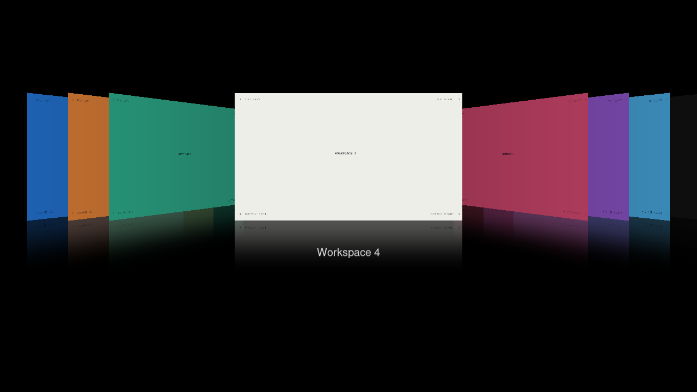

# Rendering and configuration qualification

This follow-up expands the shadow-crash coverage from [PR #7](https://github.com/sandwichfarm/hyprflow/pull/7).
The supplied crash photo shows Hyprland's crash reporter but contains no backtrace;
it cannot establish the cause of that person's crash.

## Supported scopes

The ordinary build targets **Hyprland 0.56.2/OpenGL**. The experimental Vulkan
build targets upstream [Vulkan WIP #13272](https://github.com/hyprwm/Hyprland/pull/13272)
at `b60bb19e8c8f5005a121714520acf41bd095e74b`, with the isolated runtime repairs
in the [preparation recipe](testing/vulkan/PREPARE.md). Release 0.56.2 has no
Vulkan renderer implementation. Removing Hyprflow's OpenGL guard alone would
not provide Vulkan rendering.

The Vulkan build uses real Vulkan pipelines and captured workspace textures.
It draws the perspective cards, reflections, labels, borders, desktop overlay,
and blur on an AMD Radeon RX Vega through RADV. Its qualified profile is **SDR,
normal output orientation**. Fractional scaling is tested separately within
that profile. Vulkan objects and libraries use a separate build directory.

The [machine-readable receipts](../artifacts/qualification/summary.json) identify
plugin artifacts, effective output state, and passing checks. Render evidence
comes from owned compositors and actual GPU readback, not reference-image playback.

## Passing receipts

Measured October 26, 2026, on the attached AMD Radeon RX Vega. Both libraries
passed build, geometry tests, formatting, and Cppcheck. The website/docs build,
local links, and 27 web-script tests also pass.

| Proof | OpenGL 0.56.2 | Patched Vulkan SDK |
| --- | --- | --- |
| Output/color/lifecycle matrix | 25 full-profile checks | 17 SDR/unrotated checks |
| Appearance and invalid/reload settings | 28 checks | 28 checks |
| Release-selection chords | 12 checks | 12 checks |
| Raw-client input/focus | 3 checks | 3 checks |
| Transition/lifecycle | 20 checks, Hyprexpo also loaded | 20 checks |
| Core + synchronization validation | Not a Vulkan target | Zero errors, including graceful shutdown |

Vulkan graphics receipts identify the `1e1` native build. The later `02e` and
`6a4e` builds change only the keybind and focus-cache conditions, respectively;
headers, layouts, and graphics remain unchanged. Each scope records its actual
native hash. The final SDK has a qualification-specific API suffix so an
unpatched prototype with the same upstream commit cannot pass the module's
header guard.



## Coverage and boundaries

- The OpenGL matrix exercises scale 1/1.25/1.5/2, all three rotations, mirroring,
  fractional portrait output, and scale/rotation changes while open. It compares
  accepted/canceled desktop pixels with native references.
- It exercises wide color, negotiated 10-bit buffers, HDR rejection/fallback,
  and a forced HDR image-description pipeline. The latter is a **virtual pipeline
  stress test**, not proof of physical HDR scanout or HDR color accuracy.
- Both matrix profiles exercise cross-monitor workspace rejection, removal of
  the active virtual output, and ten plugin unload/reload cycles. Additional
  outputs are headless, so they create no extra host windows.
- Appearance checks cover proportions, spacing, gradient borders, opacity,
  desktop blur, reflections, labels, invalid values, last-valid behavior, and
  file/runtime reloads. Raw-client and chord tests check input isolation,
  focus/submap restoration, and release selection.
- A Hyprland 0.56.1 negative control verifies repeated ABI rejection and a usable
  compositor afterward. This exposed an unused Aquamarine dependency collision:
  loading a newer unused library could crash the older compositor even after the
  header guard rejected the plugin. Linking with `--as-needed` removes that
  dependency. A minimal rejecting plugin reproduced the original failure.

A historical native-only Vulkan WIP **fails a rotated-output control before Hyprflow loads**:
client content is clipped/sideways and an ordinary native fullscreen roundtrip
changes a stale rounded-edge region. The full matrix keeps its pixel assertions;
`--profile vulkan-sdr` explicitly excludes that unsupported native configuration.
The module rejects rotated outputs and closes before drawing if an output transform changes while open.
Vulkan HDR/FP16, ICC, hardware cursors, explicit client sync, physical multi-monitor
scanout, and physical HDR accuracy are not qualified. The native Vulkan shadow
wrapper also lacks the window-cutout data available in the modern OpenGL path.
Vulkan backdrop blur uses a dense bilinear-paired Gaussian kernel; pixel/performance
identity with OpenGL's prefiltered separable blur is not claimed.

Exploratory NVIDIA/Wayland runs exposed parent-window configure and notification
races in the harness. These attempts are not counted as a complete current-build
NVIDIA qualification. Automated qualification uses the isolated AMD headless path.

## Reproduce the proofs

Run from an isolated Hyprflow checkout. Build before loading the library and
record its hash. Never replace or rebuild a mapped library.

```sh
make check format-check
artifact="$PWD/build/hyprflow.so"
artifact_sha=$(sha256sum "$artifact" | cut -d' ' -f1)
```

For interactive runs, `nested-session.py start` opens silently on host workspace
**5**, unpinned and without taking focus. `place` and `stop` keep that confinement.
A hidden Wayland window can stop receiving frame callbacks. For background runs,
use a headless-capable allocator; the AMD test runtime's preparation recipe
includes the explicit render-node selection and strict headless setup.
Do not create extra Wayland outputs after the launch rule expires; the matrix
uses headless outputs for its second monitor.

Once the owned session has seven calibration fixtures and the exact plugin loaded:

```sh
python3 scripts/verify-render-matrix.py "$session_dir" /tmp/hyprflow-proof/matrix \
    --artifact "$artifact" --sha256 "$artifact_sha"
python3 scripts/verify-appearance.py "$session_dir" /tmp/hyprflow-proof/appearance \
    --artifact "$artifact" --sha256 "$artifact_sha"
python3 scripts/verify-select-on-release.py "$session_dir" --artifact "$artifact"
python3 scripts/verify-input.py "$session_dir" /tmp/hyprflow-proof/input
python3 scripts/verify-lifecycle.py "$session_dir" /tmp/hyprflow-proof/lifecycle \
    --artifact "$artifact" --sha256 "$artifact_sha"
```

The appearance proof replaces fixtures for its detailed blur checks. Restore
calibration fixtures before repeating color/geometry measurements. For the
experimental Vulkan library, use the matching runtime from the recipe and add
`--profile vulkan-sdr` to the matrix command. A matching Vulkan build deliberately
rejects an OpenGL renderer; the ordinary build deliberately rejects Vulkan.

For an explicitly owned older compositor with no Hyprflow loaded:

```sh
python3 scripts/verify-plugin-rejection.py "$older_session_dir" "$artifact" \
    --sha256 "$artifact_sha"
```

Do not judge rejection by the CLI exit code: Hyprland may return zero with a load
error. This proof checks the expected reason, unchanged registry, process lifetime,
subsequent IPC, and artifact identity across three attempts.

Export selected successful receipts without host paths, process addresses, or
raw logs:

```sh
python3 scripts/summarize-qualification.py \
    opengl-matrix=/tmp/hyprflow-proof/matrix/manifest.json \
    opengl-appearance=/tmp/hyprflow-proof/appearance/manifest.json \
    --output /tmp/hyprflow-proof/summary.json
```

The exporter rejects failed receipts, incomplete input restoration, forced flow
cleanup, changed screenshot hashes, and private session paths in the export.
The raw-input/lifecycle probes retain one virtual keyboard through animations and
focus restoration, matching a continuously connected physical keyboard. Keyboard
hot-unplug recovery is a separate unqualified case.

Keep failed attempts and native controls alongside the local evidence; do not
turn a failed vector into a passing support claim. Stop every owned session when
finished. The daily compositor's configuration, plugin list, and renderer are
outside these tests.
